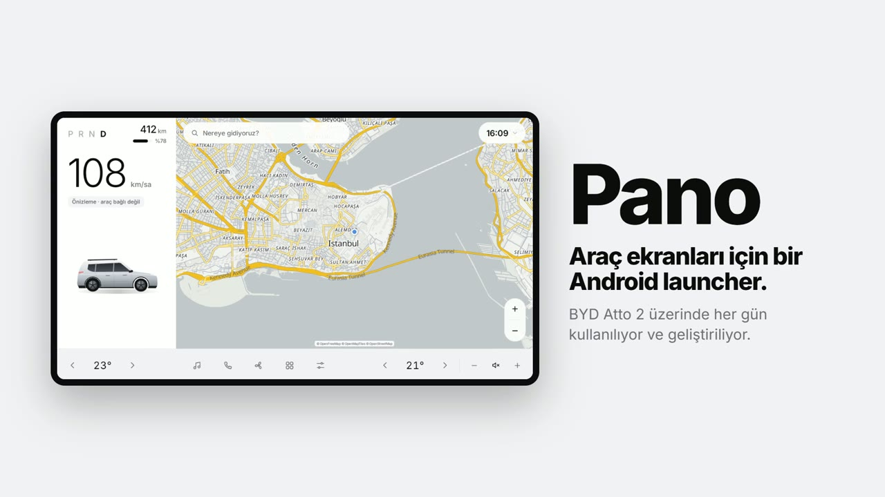
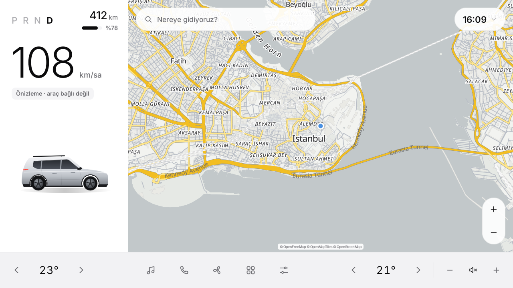
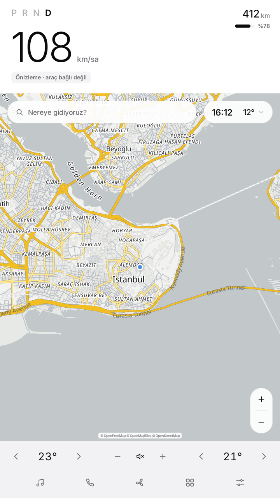
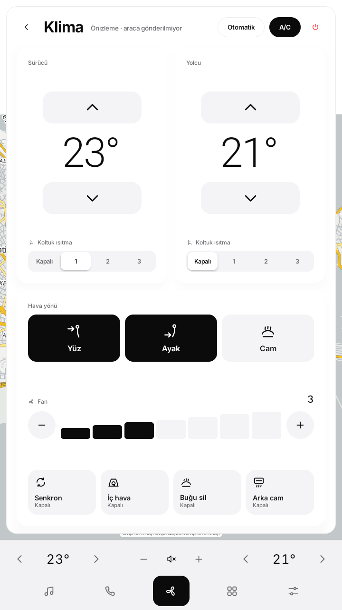

# Pano

Araç ekranları (BYD DiLink gibi Android head unit'ler) için Jetpack Compose ile yazılmış bir Android launcher. BYD Atto 2 (DiLink 3.0, Android 10) üzerinde günlük kullanılıyor ve geliştiriliyor.

[](https://github.com/batuhankul61-hub/Pano/releases/download/v142/Pano-tanitim.mp4)

▶ **[Tanıtım videosunu izle](https://github.com/batuhankul61-hub/Pano/releases/download/v142/Pano-tanitim.mp4)** (1 dk; müzik: Sascha Ende, ende.app, CC BY 4.0)



<p>
  
  
</p>

> Ekran görüntüleri emülatörden, örnek verilerle (araç bağlı değil, "Önizleme").

## Neler var

- **Ufuk düzeni**: solda araç sütunu (vites, hız, menzil, sürüş modu, kapı/cam durumu, şarj), sağda büyük harita, altta klima ve uygulama çubuğu. Sürüşte sütun daralır, harita büyür.
- **Dikey ekran**: BYD'nin dönen ekranında araç bilgileri üste, uygulama çubuğu iki sıraya geçer; yazılar yataydaki boyda kalır.
- **Araç verisi** (BYD veri yolu): hız, vites, batarya ve menzil, kapı/cam/bagaj, sürüş modu, rejen, tüketim, şarj durumu. Veri yoksa uydurulmaz; "Önizleme" yazar.
- **Klima**: sıcaklık, fan, hava yönü, A/C, iç hava, buğu çözme, koltuk ısıtma.
- **Harita ve navigasyon**: MapLibre + OpenFreeMap (anahtarsız), Türkçe rota (Valhalla), ev/iş kısayolları, yakındaki şarj istasyonları, hız sınırı.
- **Müzik ve radyo**: çalan parça, BYD radyosu (FM/DAB), kaydırarak parça değiştirme.
- **Telefon**: son aramalar, kişiler, tuş takımı; görüşmede BYD penceresi yerine Pano'nun kartı.
- **Uygulamaların üstünde şerit**: başka bir uygulama açıkken bile eve dönüş, klima, ses ve hızlı ayarlar.
- **Hızlı ayarlar**: parlaklık, tema, Bluetooth/Wi-Fi durumu, ekranı karartma, koltuk/direksiyon ısıtma.
- **Pano Asistan** (isteğe bağlı): Gemini Live ile sesli asistan; kendi API anahtarınla çalışır.
- **Kendini güncelleme**: Ayarlar › Güncelleme bu deponun son sürümünü bulur ve kurar.

Klasik ve CarPlay tarzı iki düzen daha Ayarlar'dan seçilebilir.

## Kurulum

1. [Releases](https://github.com/batuhankul61-hub/Pano/releases/latest) sayfasından son `Pano-0.2.x.apk` dosyasını indir.
2. Araca ya da Android cihaza kur (Android 8.0 ve üstü). BYD'de USB bellekten ya da `adb install -r Pano-0.2.x.apk` ile.
3. Sonraki sürümler Pano'nun içinden güncellenir: Ayarlar › Güncelleme › Denetle.

Bazı özellikler ek izin ister (diğer uygulamaların üzerinde gösterme, erişilebilirlik hizmeti, bildirim erişimi); Pano gerektiğinde nereden açılacağını gösterir.

## Derleme

```powershell
$env:JAVA_HOME = "C:\Program Files\Android\Android Studio\jbr"
.\gradlew.bat :app:assembleDebug
```

Release imzası için proje kökünde `keystore.properties` gerekir (şablon: `keystore.properties.example`). Ayrıntılı geliştirme notları: [CLAUDE.md](CLAUDE.md), BYD sinyalleri: [docs/byd-sinyal-sozlugu.md](docs/byd-sinyal-sozlugu.md).

## Teşekkür

BYD veri yoluna erişim [ESMER-UI](https://github.com/akyuznet/ESMER-UI)'den (MIT) uyarlandı; lisans metni `vehicle/BydBus.kt` dosyasının başında.

Pano BYD ile bağlantılı değildir.
